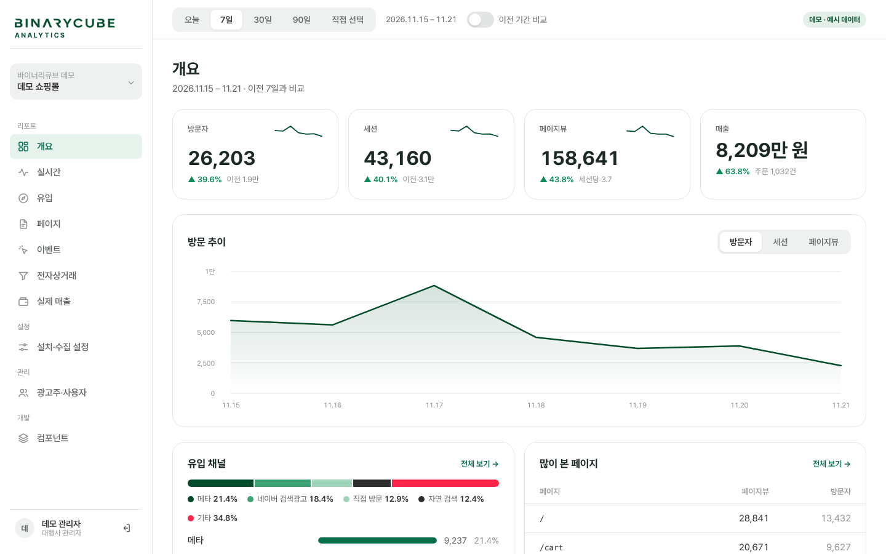

# 22-analytics
BinaryCube Analytics — 멀티 프로젝트 웹 분석 + 주문번호 기준 매체 간 매출 중복 소거 플랫폼.

- 대행사 내부 전용 도구 (SI)

## 데모

백엔드 없이 브라우저 안에서만 도는 데모 대시보드입니다. 숫자는 모두 예시 데이터입니다.

- 주소: https://sogangcsmaster.github.io/22-analytics/
- 로그인: 아무 이메일·비밀번호로 들어갑니다 (빈 값도 됩니다).
- 로그인부터 개요·실시간·유입·페이지·이벤트·전자상거래·실제 매출(중복 소거)·설정·관리 화면까지 모두 볼 수 있습니다.
  설정 변경은 브라우저(localStorage)에만 남습니다.



### 동작 방식

- Cargo 기능 `demo`(`crates/web`, 기본 꺼짐)로 빌드하면 모든 API 호출이 `crates/web/src/api.rs`의 `raw()` 한 곳에서
  브라우저 안의 데모 서버(`crates/web/src/demo/`)로 바뀝니다. 응답은 실제 API와 같은 DTO(`analytics_core::dto`) JSON이고,
  검증 오류·401도 같은 코드로 돌려줍니다.
- 예시 데이터는 프로젝트 id·날짜로 시드한 결정적 난수로 만듭니다: 광고주 1곳(바이너리큐브 데모), 프로젝트 2개(데모 쇼핑몰, 데모 브랜드몰),
  서울 기준 최근 120일, 성장 추세·주말 계절성·블랙프라이데이 급증, 오늘은 현재 시각만큼만 쌓입니다.
- 실제 매출은 `analytics_core::attribution`(실제 기여 연산과 같은 코드)으로 계산해 모든 모델에서 채널 합 = 실제 매출입니다.

### 로컬에서 실행

```sh
make demo          # dx serve → http://localhost:8080 (예시 데이터, 아무 값으로 로그인)
make demo-pages    # GitHub Pages용 릴리스 번들 (/22-analytics/ 경로)
make e2e-demo      # 브라우저 확인: /22-analytics/ 경로 + 404.html 폴백, 스크린샷 docs/screenshots/demo-*.png
cargo test -p analytics-web --no-default-features   # 데모 서버 단위 테스트 포함
```

### GitHub Pages 배포

`main`에 push하면 `.github/workflows/pages.yml`이 데모를 빌드해 배포합니다. 처음 한 번 저장소 Settings → Pages →
Build and deployment → Source를 **GitHub Actions**로 설정해야 합니다 (비공개 저장소의 Pages는 유료 플랜이 필요합니다).
